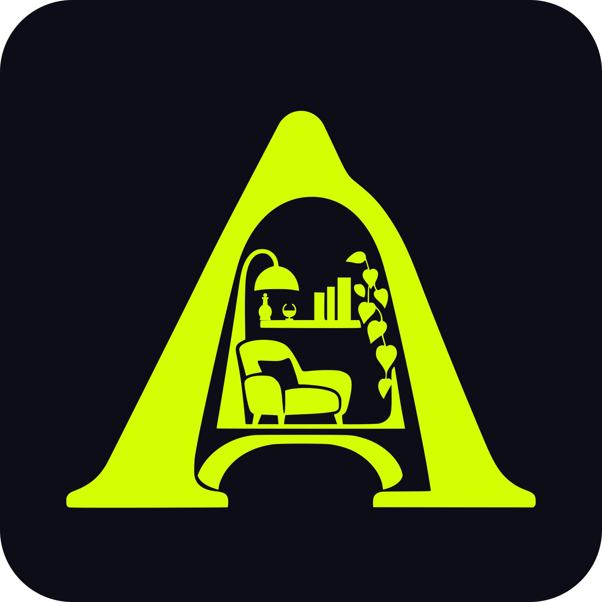
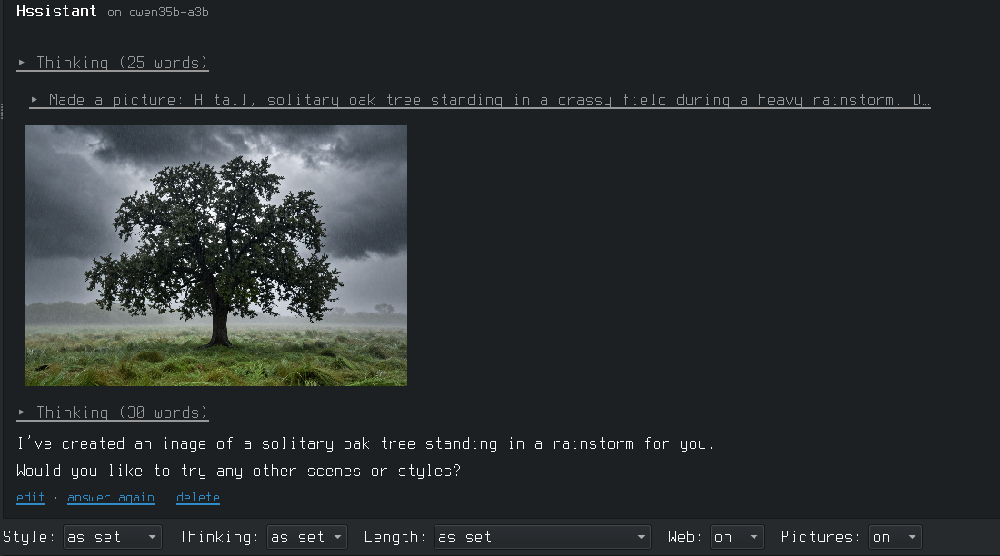

# AIcove

**[aicove.dev](https://aicove.dev)** · **[Wiki](https://github.com/overcatbe/aicove/wiki)** (the guide, one page per topic) · **[What's new](CHANGES.md)**

A desktop window for chatting with personas that run on local models
([llama.cpp](https://github.com/ggml-org/llama.cpp)), on Linux. One user, one machine, no
browser and no server of its own: the window talks to llama-server on this machine.

## Why AIcove exists

We liked Open WebUI. It did what we needed, until it started growing into something we didn't need.

User management, teams, permissions, collaboration features, additional services and an
increasingly large dependency stack. All useful to somebody, no doubt. But not to someone sitting
at their own Linux machine, wanting a private conversation with a locally running AI.

Our Open WebUI install took almost 3.6 GB of disk space before a single model was downloaded,
and it felt considerably slower. That's an extraordinary amount of infrastructure for what we
actually wanted: a window to talk to our personas.

So we built AIcove.

**Linux first, not as an afterthought.** AIcove is a native PyQt6 desktop application, developed
on Slackware. No browser frontend, no Electron, no separate web application server.

**One person, one private environment.** AIcove has no user accounts, shared workspaces, team
permissions or remote access interface, and it opens no network port of its own. It communicates
with a locally running llama-server. Web access is optional and explicitly enabled per
conversation. File access is restricted and controlled by the user.

**Small and fast.** AIcove doesn't need a browser engine and an entire web application stack to
display a conversation. It starts quickly, uses few resources and leaves your memory and
processing power available for the models that actually need them.

**Personas before models.** You choose who you want to talk to, not which model you want to
operate. Each persona has its own identity, knowledge, memories and conversation history. The
underlying model can change without losing that history.

**Your files, your control.** Conversations, persona definitions, memories and notes live in
ordinary, readable files. Open them in your favourite editor, back them up with rsync or move
them to another machine. Nothing is locked away in an opaque application database. Permanent
memories are accepted by you, not silently decided by the model.

We aren't trying to recreate every feature of Open WebUI, SillyTavern or the growing collection
of AI platforms. AIcove is deliberately designed for a narrower purpose: giving one person a
fast, private, portable and comfortable environment for their local AI personas.

We believe software should serve its user, not require its user to administer an increasingly
complicated software platform.

**Your RAM is for your models, not your chat interface.**

## What it does

- **Chat**: pick a persona and talk. Its model is loaded when needed; chats are files in the
  persona's folder. Thinking is shown folded, Markdown and code are rendered. Per chat: style,
  thinking, length, web search, pictures. Long chats are summarised, a persona keeps facts
  between chats (only the ones you accept) and can have a knowledge folder.
- **Voices and pictures** (optional): answers read aloud through a voice server, pictures made
  through an image server (stable-diffusion.cpp's sd-server). See below.

- **Agents**: a persona with a standing task that runs on its own (now or on a schedule) and
  comes back with reports, e.g. a story hunter that searches the web for your themes.
- **Writing**: long texts (a novel, a fic) as projects of chapters. Import from pasted text,
  HTML or PDF; one line per paragraph; talk with a persona about the open chapter, its changes
  come into the text in red and green to accept or decline; a Review mode that only writes notes
  (a checker for slop phrases, gestures, dialogue runs and repetition, and a review by the
  persona); a story memory (chapter notes, cast, threads, your style and plans) that goes along
  with every question; export to Markdown, text, HTML, PDF, EPUB or Word, and Copy for AO3.
- **Launchers**: one model with its settings (context size, how much goes on the GPU, writing
  style, ...), edited as a form, with an estimate of the memory it needs. Start and stop from the window.
- **Personas**: a name, picture, system prompt and settings, and the launchers it may run on.
  Each has its own folder in `~/AIcove/personas/`, with its chats, knowledge and notes.
- **Add model**: from a Hugging Face link (shows which version fits this machine) or a file on disk.
- **File access for models**: a persona can be allowed to read files (system files too) and
  to write text files in folders you name, each change only after your OK. No commands. Each such persona has a
  folder of its own (`~/AIcove/personas/<persona>/knowledge` and `/notes`) that only it can read
  and write in: its own material, and its memory between chats. It can also read the guide of the
  Documentation tab and your notes file, so it can answer questions about the machine.
- **Tools**: the other things of the machine you start and stop (voice tools, a local web
  server, a browser profile, ...), one row each with Start, Stop, Open and buttons of your own.
- **Passwords**: a small password manager on top of GnuPG: search, copy (the clipboard is
  emptied again after 45 seconds), edit, generate, entries sorted by type, an import of browser
  exports, and sync between your machines through git.
- **Documentation**: the user guide, with search, and your own notes file next to it.
- **Settings**: everything that differs from machine to machine, with a Check button.

It does not contain llama.cpp. Install it yourself; the Settings tab points at it.

## Install

Needs Python 3.11+, PyQt6, python-markdown, Pygments and curl; the Passwords tab also needs gpg and git, voices like ffmpeg. On Manjaro/Arch: `sudo pacman -S python-pyqt6 python-markdown python-pygments`.

    git clone https://github.com/overcatbe/aicove.git ~/Projects/aicove
    ~/Projects/aicove/install.sh

`install.sh` links the `aicove` command onto the PATH and adds a menu entry and a desktop icon.
The program runs from the cloned folder, so updating is `git pull` in it.

The first start opens the Settings tab filled with what was found on the machine (llama-server,
model folder, GPU). Correct it, press **Check**, then **Save**.

The top bar can hold buttons that switch the keyboard layout: `keyboard` is a list of
`"Label | command"` lines, and `keyboard_now` an optional command whose answer names the
active one. Empty = no buttons.

## Where things are

| What | Where |
|---|---|
| Settings of this machine | `~/.config/aicove/config.toml` |
| Launchers | `~/.config/aicove/launchers/<name>.txt` |
| Personas, their chats, knowledge and notes; agents and their reports; writing projects; documents; work (yours: copy it to move) | `~/AIcove/` (the folder is a setting) |
| Tools | `~/.config/aicove/tools/<name>.txt` |
| Passwords | `~/.password-store/` (the folder is a setting) |
| Logs, pid files, download jobs, old versions of saved launchers and tools | `~/.cache/aicove/` |

All of these are plain text and can be edited by hand. A launcher file:

    name: Qwen3.5-9B Defiant Fable
    description: uncensored creative, Q8
    model: qwen3.5-9b-defiant-fable.gguf
    gpu_layers: all
    options: -c 32768 --parallel 1 --jinja

`model` (and `eyes`, the mmproj file of an image model) are relative to the model folder from
the settings. `gpu_layers` is `all`, `auto` (as much as fits, the rest runs from normal RAM)
or a number of layers; without the line the default from the settings is used. `options` goes
to llama-server as written.

Launchers belong to one machine, because the model files differ. Everything in `~/AIcove/` is
yours and moves by copying the folder. A persona names its launchers (`models: a, b` in its
`persona.txt`); on a machine without them, pick others on the Personas tab.

A tool file (Tools tab, "Add tool…" writes the same):

    name: Voice configurator
    description: VoxCPM2, pick and tune voices
    group: Voice
    start: HF_HUB_OFFLINE=1 exec tts-env/bin/python voxcpm_config_ui.py
    folder: ~/voice-ui
    address: http://localhost:7871
    stop_everything: yes
    not_with: voice-quick

`start` and `stop` are shell commands, run in `folder`. Two kinds of tool:

- **No `stop` line**: the start command *is* the program. AIcove keeps it running in the
  background (log and pid in `~/.cache/aicove/tools/`) and Stop ends it with everything it started.
- **With a `stop` line**: both commands are run and expected to come back, like
  `start: mysite-dev start` / `stop: mysite-dev stop`.

`group` puts the tool under a heading of that name in the Tools tab (tools without one go
under "Other"); click a heading to fold the group away, and a folded heading says how many of
its tools run. `address` gives the Open button and tells whether the tool runs (something answers there).
`terminal: yes` runs start and stop in a terminal window, for commands that ask for a password
or a yes/no. `stop_everything: yes` lets "Stop everything" stop it. `not_with` names tools
that are stopped before this one starts. `not_with_model: yes` is for tools that need the GPU
memory: starting the tool stops the loaded model, and loading a model stops the tool. Any number of `button: Label | command` lines add
buttons of your own; those always run in a terminal window. The terminal program is on the
Settings tab.

## Voices and pictures (optional)

Both are off until you set them up; AIcove contains neither model.

**Pictures**: any server with the OpenAI image API (`POST /v1/images/generations`, answering
`b64_json`). Tested with [stable-diffusion.cpp](https://github.com/leejet/stable-diffusion.cpp)'s
`sd-server` and Z-Image-Turbo. A tool file for it:

    name: Pictures
    description: stable-diffusion.cpp, Z-Image-Turbo
    start: exec build/bin/sd-server --backend te=cpu --listen-port 7860 --diffusion-model /path/to/z_image_turbo-Q8_0.gguf --vae /path/to/ae.safetensors --llm /path/to/Qwen3-4B-Instruct-2507-Q8_0.gguf --cfg-scale 1.0 --steps 8 -s -1
    folder: ~/src/stable-diffusion.cpp
    address: http://127.0.0.1:7860
    not_with_model: yes

and on the Settings tab `pictures` = `pictures` (the tool's file name) or the address of a
server running elsewhere. `-s -1` gives every picture a new seed. `--backend te=cpu` runs the
text encoder on the CPU, which leaves GPU memory for the chat model. Give the chat model's launcher
a fixed context (`-c 32768`): without one, llama-server fills all free GPU memory. `not_with_model: yes` if the
GPU can't hold both.

**Voices**: a [Gradio](https://www.gradio.app/) app with two API endpoints, set as `voice` on the
Settings tab (a tool name or an address):

- `voices` (no inputs): returns a list of `{"id", "name", "language", "gender", "style"}`, the
  voices a persona can have (only `id` and `name` are needed).
- `speak` (inputs: text, voice id): returns the spoken text as an audio file (WAV).

AIcove calls them as `POST /gradio_api/call/<name>` and reads the result stream. Any TTS model
works behind it (VoxCPM, XTTS, Piper, ...); a minimal one with Gradio:

    import gradio as gr
    def voices(): return [{"id": "anna", "name": "Anna"}]
    def speak(text, voice): ...; return "/tmp/out.wav"
    with gr.Blocks() as app:
        t, v, out, lst = gr.Textbox(), gr.Textbox(), gr.Audio(type="filepath"), gr.JSON()
        gr.Button(visible=False).click(speak, [t, v], out, api_name="speak")
        gr.Button(visible=False).click(voices, None, lst, api_name="voices")
    app.launch(server_port=7871)

Audio is kept as MP3 when `ffmpeg` is installed, otherwise as WAV.

## Passwords

One file per entry in `~/.password-store/`, encrypted with GnuPG for the key named in
`.gpg-id` there. It is the layout of the [`pass`](https://www.passwordstore.org/) program, so
the files can be read without AIcove (`pass show NAME`, or `gpg -d NAME.gpg`). In a file:
line 1 the password, then optional `user: ...` and `url: ...`, then free notes.

The top folder of an entry is its type: `web`, `mail`, `social`, `shopping`, `finance`, `gov`,
`games`, `media`, `app`, `wifi`, `pc`, `server`, `db`, `vpn`, `crypto` or `other`
(`web/example.com/me@example.com`). The list is grouped by type (click a heading to fold it),
the menu above it shows one type only, and the form has a type menu in front of the name.
Entries outside these folders are listed under "(no type)"; pick a type and save to move one.

**More → Import CSV** reads the export of Chromium, Chrome, Firefox, Bitwarden and most other
password managers (Chromium: Settings → Passwords → Export). It lists the logins without their
passwords and gives each a type from its site; untick, retype or rename what doesn't fit, then
everything is encrypted and committed at once. Afterwards it offers to shred the CSV file,
which holds every password in plain text.

AIcove does no encryption of its own and never sees the master password: GnuPG asks for it in
its own window and remembers it for a while (**Lock** makes it forget). A password only ever
goes into the form and the clipboard, never into a log or the output pane.

The folder is a git repository and every change is a commit, so old versions of an entry
are kept. To use the store on a second machine:

1. First machine: **More → Set sync address** (a git address you can push to, such as
   `myserver:passwords.git`, an empty bare repository), then **Sync now**.
2. First machine: **More → Export key**. Carry that file over by hand; it is not put on the server.
3. Second machine: **Get my store from another machine…**, then **More → Import key**. Delete
   the key file on both.

After that **Sync now** on either machine exchanges the changes. If the same entry was
changed on both, nothing is merged until you say which version counts (More menu).

## From a terminal

The window is the program; these are the same actions without it.

    aicove                        open the window
    aicove start NAME             load a launcher's model, or a persona on its model
    aicove stop | stop all        the model | the model and the tools marked for it
    aicove chat PERSONA ["message"]   its chats | a new chat (also: PERSONA last "message")
    aicove passwords [sync]       names of the password entries | sync the store
    aicove tools                  the tools and whether they run
    aicove tools start|stop NAME  one of them
    aicove status | list | check

`aicove` alone prints nothing and opens the window; `aicove help` lists everything.

## Code

| File | Does |
|---|---|
| `cove/gui.py` | the window |
| `cove/settings.py` | config.toml, finding programs and the GPU, Check |
| `cove/launchers.py` | launcher files, the llama-server command line |
| `cove/server.py` | start/stop of llama-server |
| `cove/chat.py`, `cove/gui_chat.py` | chats as files, replies from llama-server; the Chat tab |
| `cove/folder.py` | the AIcove folder |
| `cove/passwords.py`, `cove/gui_passwords.py` | the password store (GnuPG, git) and its tab |
| `cove/gui_docs.py`, `cove/data/guide.md` | the Documentation tab and the guide it shows |
| `cove/tools.py` | tool files, their start/stop, terminal windows |
| `cove/personas.py` | persona files and pictures |
| `cove/fetch.py` | resuming downloads behind "Add model" |
| `cove/files.py` | the file tools of the chat, with all their rules |
| `cove/summary.py` | the summary of long chats |
| `cove/facts.py` | what a persona remembers between chats |
| `cove/knowledge.py` | a persona's knowledge folder: in the prompt, or looked up with tools |
| `cove/web.py` | web search and reading pages, for chats with Web on |
| `cove/voice.py` | reading answers aloud through a voice server's API |
| `cove/pictures.py` | pictures in the chat through an image server (sd-server) |

Testing without touching the real setup: set `AICOVE_CONFIG`, `AICOVE_STATE` and
`AICOVE_FOLDER` to empty folders (or copies) and `QT_QPA_PLATFORM=offscreen`; give the sandbox's `config.toml` other ports if a
model is loaded for real.

The memory estimate reads the size of the expert weights from the model file for launchers
with `--cpu-moe` or `--n-cpu-moe`. Memory estimates assume an NVIDIA card (`nvidia-smi`) or an AMD chip (`amdgpu` in `/sys`); for
anything else set the GPU memory by hand on the Settings tab.

## License

AIcove is free software under the [GNU GPL v3](LICENSE) or later, with three additional
terms under its section 7 (see [NOTICE](NOTICE)):

- **Credit stays**: every copy, changed or not, keeps "AIcove, originally by overcat.be
  (https://aicove.dev)" in its documentation and wherever it names its authors.
- **Changes are marked**: a modified version says it is changed and doesn't claim to be AIcove.
- **Forks get their own name**: the license gives no rights to the name "AIcove" or its logo.
  A modified version needs another name and logo; unmodified copies may keep them.

So you may use, study, change and share AIcove freely, and what you build on it stays free too.

## Made with

AIcove was conceived and is maintained by overcat.be, with substantial development by Claude
Opus 5.5 (Anthropic) in Claude Code. Architecture, features, testing and release decisions stay
with its maintainer.
